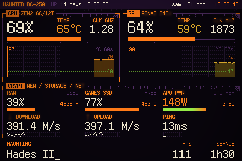
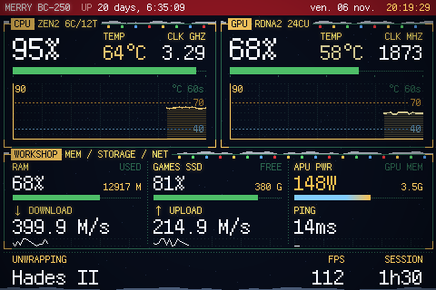
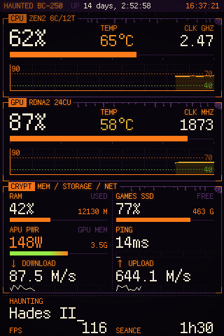
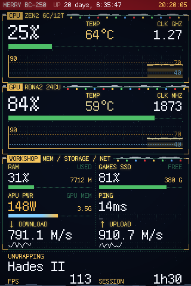

# BC250 themes

[](https://github.com/raphaeltournafond/bc250-themes/actions/workflows/tests.yml)

Ten themes for [turing-smart-screen-python](https://github.com/mathoudebine/turing-smart-screen-python), made for a **3.5" Turing screen** (landscape or portrait) on an **AMD BC-250 Steam Machine running Bazzite**. Each has its own boot animation. Pick one with `--theme`:

<table>
  <tr>
    <td align="center" width="20%"><br><b>Phosphor</b><br>(default)<br>green CRT terminal</td>
    <td align="center" width="20%"><br><b>Game Boy</b><br><code>gameboy</code><br>handheld RPG</td>
    <td align="center" width="20%"><br><b>Retrowave</b><br><code>retrowave</code><br>neon arcade sunset</td>
    <td align="center" width="20%"><br><b>Videotex</b><br><code>videotex</code><br>French videotex</td>
    <td align="center" width="20%"><br><b>Mission Control</b><br><code>mission</code><br>1969 flight console</td>
  </tr>
  <tr>
    <td align="center" width="20%"><br><b>Minecraft</b><br><code>minecraft</code><br>blocky inventory</td>
    <td align="center" width="20%"><br><b>Nixie</b><br><code>nixie</code><br>Nixie tubes</td>
    <td align="center" width="20%"><br><b>Radar</b><br><code>radar</code><br>live flights around you</td>
    <td align="center" width="20%"><br><b>Halloween</b><br><code>halloween</code><br>pumpkins, a graveyard</td>
    <td align="center" width="20%"><br><b>Christmas</b><br><code>christmas</code><br>snow and Santa's sleigh</td>
  </tr>
</table>

Nine of them show the same live data: CPU, GPU, system, and what the machine is playing or downloading. The radar trades some of it for live flights around a point you choose. Portrait layouts, boot animations and details are under [Themes](#themes).

## Quick start

1. **Get the theme** in the folder that holds your `turing-smart-screen-python` folder (or in your home, if the app is at `~/turing-smart-screen-python…`):
   ```bash
   git clone https://github.com/raphaeltournafond/bc250-themes
   ```
   Don't have the app yet? Get it into your home folder first:
   ```bash
   git clone --depth 1 --branch 3.10.0 https://github.com/mathoudebine/turing-smart-screen-python ~/turing-smart-screen-python
   ```
2. **Run the setup** (plug the screen in first):
   ```bash
   bash bc250-themes/setup.sh
   ```
3. **For FPS in games**, paste this into each game's *Properties > Launch Options* in Steam:
   ```
   MANGOHUD_CONFIG=fps_only,alpha=0,autostart_log=1,log_interval=1000,output_folder=~/mangologs mangohud %command%
   ```

That's it: the screen now starts with the boot animation every time the BC-250 boots.

| To… | Run |
|---|---|
| update the theme | `git -C bc250-themes pull && bash bc250-themes/setup.sh` |
| switch theme | `bash bc250-themes/setup.sh --theme gameboy` (or `retrowave`, `videotex`, `mission`, `minecraft`, `nixie`, `radar`, `halloween`, `christmas`, `phosphor`) |
| change an option | `bash bc250-themes/setup.sh --night 23:30-08:00 --logo "MY RIG"` (remembered for next time) |
| go back to the defaults | `bash bc250-themes/setup.sh --reset-options` |
| remove it | `bash bc250-themes/setup.sh --uninstall` |

### What setup does

- **Finds the app:** it uses `--app PATH` if given, then the folder from last time, then a `turing-smart-screen-python*` folder next to this one or in your home.
- **Python libraries:** uses the Python that already has the app's libraries. If none does, it installs them into a private `.venv` inside the app folder (nothing system-wide).
- **Screen access:** checks your account can talk to the screen, and offers the fix if not (including the Bazzite/Fedora Atomic `dialout` group quirk).
- **Theme:** installs it and builds the artwork with your username, hostname and options. It also sets `THEME` and the network interface in the app's `config.yaml`.
- **Start at boot:** runs the monitor as a systemd user service, and restarts it after an update.
- **Health check:** finishes with `bc250_check.py`, which reports every data source and how to fix anything missing.

## Themes

Click a theme for its portrait layout, its boot animation and what's special about it. What they all show is under [What's on screen](#whats-on-screen).

<details>
<summary><b>Phosphor</b> (default): a retro green-phosphor terminal</summary>

<br>

 

- **Boot:** a CRT warm-up, then the "Phosphor BIOS" with a 3D logo.
- **Temperatures:** green → orange (70 °C) → red (80 °C).


</details>

<details>
<summary><b>Game Boy</b> <code>--theme gameboy</code>: the 4-shade DMG screen as a handheld-RPG status screen</summary>

<br>

 

- CPU and GPU are party cards with HP bars, there's an ITEMS box, and a dialog box at the bottom ("RAFALE IS PLAYING").
- **Boot:** your logo drops in, then a SYSTEM CHECK menu with a ▶ cursor and an HP-style loading bar.
- **Temperatures:** only 4 shades, so it darkens instead of changing colour.


</details>

<details>
<summary><b>Retrowave</b> <code>--theme retrowave</code>: neon pink and cyan on a purple night</summary>

<br>

 

- Arcade wording at the bottom ("1UP RAFALE NOW PLAYING", "INSERT COIN" when idle).
- **Boot:** the backlight fades up on a sunset and a scrolling neon grid, a laser scans in the chrome logo, then a SYSTEM CHECK panel with a pink-to-cyan loading bar and a blinking PRESS START.
- **Temperatures:** cyan → pink → sunset orange.


</details>

<details>
<summary><b>Videotex</b> <code>--theme videotex</code>: a French 40-column videotex page in 8 flat colours</summary>

<br>

 

- In French. CPU and GPU are coloured pages with mosaic bar charts of their temperature, under a teletext header (`P250 BC-250 … ven. 16 oct. 21:30:12`), and the bottom line is a ticker ("EN COURS : Hades II").
- **Boot:** `3615 BC250` is typed in, "Connexion..." and the modem handshake as text, the corner goes from F to C, then the page builds row by row and the self-test fills its table.
- **Temperatures:** green → yellow → red blocks.


</details>

<details>
<summary><b>Mission Control</b> <code>--theme mission</code>: a 1969 flight-controller console</summary>

<br>

 

- White and amber telemetry in CRT windows set in grey. CPU and GPU are STAGE 1 and STAGE 2, temperatures read THERMAL, APU power PWR BUS, and the header shows the mission elapsed time (your uptime, `MET 003:14:22:05`) and the day of the year. The bottom line reads "FLIGHT: Hades II", or "HOLDING" when idle.
- **Boot:** the flight director runs a GO/NO-GO poll of every station with GO / HOLD / NO GO lamps, gives the verdict, then the countdown goes T-10, IGNITION, LIFTOFF with a flash.
- **Temperatures:** white → amber → red, and `ALARM` instead of `HOT!`.


</details>

<details>
<summary><b>Minecraft</b> <code>--theme minecraft</code>: light grey inventory panels on dark dirt</summary>

<br>

 

- CPU and GPU sit on creative-menu tabs, load bars are XP bars, the temperature history is a column of little blocks, and the bottom line is a chat box ("PLAYING Hades II", "rafale is AFK").
- **Boot:** your logo built from stone blocks with a random yellow splash line pulsing, "Loading world" for the self-test, then "Building terrain".
- **Temperatures:** green → gold → red blocks.


</details>

<details>
<summary><b>Nixie</b> <code>--theme nixie</code>: a Nixie-tube instrument panel</summary>

<br>

 

- Neon-orange digits behind their anode mesh on a black front with brass engraving. A six-tube clock on top; CPU and GPU load, temperature and clock on tubes with glowing bar tubes and a red warning lamp; RAM, SSD and APU power on tubes too.
- **Boot:** the tubes strike one by one, spin like a slot machine and settle on the time, then a neon lamp per check lights up for the self-test (orange OK, red problem).
- **Temperatures:** the tubes only glow orange: from 80 °C the temperature tubes blink and a red neon lamp lights.


</details>

<details>
<summary><b>Radar</b> <code>--theme radar</code>: live aircraft around a point you choose</summary>

<br>

 

- From free community ADS-B data. A military-green radar scope over a faint relief map (hillshade and contour lines), with range rings, the airports and runways in range, and a sweeping beam.
- Each aircraft is a target that flashes as the beam passes and fades behind it, shaded by altitude (yellow-green low, green mid, teal high, red for an emergency squawk), with an ATC-style tag (callsign, flight level, speed).
- Beside it: the nearest flight in big letters (callsign, route, airline, altitude, speed, type, distance), the next four, CPU and GPU temperature and load, and what's playing.
- **Boot:** the scope itself comes on (it is the dashboard's), its range rings light up, a console log runs the self-test and opens the data link, the first contacts appear, then the sweep starts right away.


**Setting it up:**

```bash
bash bc250-themes/setup.sh --theme radar --radar-lat 48.8584 --radar-lon 2.2945 --radar-range 50
```

- Coordinates in decimal degrees (Google Maps: right-click a spot); `48°51'30"N` style works too, quoted. Range 5 to 400 km.
- Your coordinates stay on the BC-250 (in the saved setup options), and are sent only to the data services below.
- Data: aircraft from [adsb.lol](https://adsb.lol) (falls back to [adsb.fi](https://adsb.fi)), routes from [adsbdb](https://www.adsbdb.com), airports from [OurAirports](https://ourairports.com) and relief from the [Terrain Tiles on AWS](https://registry.opendata.aws/terrain-tiles/) (Mapzen; SRTM, EU-DEM and others), both downloaded once at setup into `~/.cache/bc250-themes`. Free community services for personal use: the radar asks every 6 s and stops while the screen sleeps. Routes are only shown when they fit where the aircraft actually is (community route data can be stale).
- `bc250_check.py` tells you whether the data services answer.
- Tip: a plane-spotting screen should stay bright: add `--dim-after 0`.

</details>

<details>
<summary><b>Halloween</b> <code>--theme halloween</code>: pumpkins, cobwebs and a graveyard under the full moon</summary>

<br>

 

- Pumpkin-orange labels with a candle-like glow and bone-white values on a purple night. The frames and the header melt into drips, and cobwebs hang in the corners. The CPU and GPU panels sit above the CRYPT.
- The bottom line haunts: "HAUNTING Hades II" with its SEANCE time, "SUMMONING" a download, "BREWING SHADERS", and "the crypt is quiet" when idle.
- **Boot:** lightning flashes show a graveyard under the full moon, your logo bleeds in from the top in dripping red letters, then the self-test is a séance (ALIVE, STIRRING, CURSED, BURNING) while two jack-o'-lanterns flicker and bats cross the moon. "Raising the dead..." fills its bar, and a last thunderclap: IT'S ALIVE!
- **Temperatures:** slime green → pumpkin → blood red, and `BOO!` flashes instead of `HOT!`.


</details>

<details>
<summary><b>Christmas</b> <code>--theme christmas</code>: snow, a lit tree and Santa's sleigh on a silent night</summary>

<br>

 

- Gold labels and snow-white values on a midnight blue night, under a holly-red header. Snow lies on the pine-green frames, strings of coloured lights hang from them, and the system panel is the WORKSHOP.
- The bottom line is festive: "UNWRAPPING Hades II", "DELIVERING" a download, "CHECKING TWICE", "BAKING SHADERS", and "ALL IS CALM" / "all is bright" when idle.
- **Boot:** a silent snowy night fades in with snow falling, your logo appears in red under its snow caps, and someone switches the tree on. The self-test is Santa's list (NICE, WRAPPING, NAUGHTY, MELTING) while the sleigh crosses the sky, its lead reindeer's nose glowing. "Loading the sleigh..." fills a candy-cane bar, then MERRY CHRISTMAS!
- **Temperatures:** ice blue → gold → red, and `MELT` flashes instead of `HOT!`.


</details>

*Game Boy- and Minecraft-inspired fan themes, not affiliated with or endorsed by Nintendo, Mojang or Microsoft; they use no logos or game assets (all art is drawn by `make_theme.py`). Retrowave's logo uses the Race Space font that comes with the app (free for non-commercial use).*

## Options

| Option | Default | Effect |
|---|---|---|
| `--theme NAME` | `phosphor` | `phosphor` (green terminal), `gameboy` (4-shade RPG status screen), `retrowave` (neon sunset), `videotex` (French videotex pages), `mission` (1969 mission control), `minecraft` (blocky inventory), `nixie` (Nixie tubes), `radar` (live flights), `halloween` (pumpkins and a graveyard) or `christmas` (snow and Santa's sleigh) |
| `--portrait` | landscape | portrait layout (320×480): panels stacked, 2×3 grid |
| `--logo TEXT` / `--subtitle TEXT` | `BC-250` / `STEAM MACHINE` | boot splash title and the line under it |
| `--user NAME` / `--host NAME` | your login / hostname | the `user@host:~$` prompt |
| `--title TEXT` | `<LOGO>::<USER>` | header text |
| `--cold C` / `--hot C` / `--alert C` | `40` / `70` / `80` | temperature colours (shades on the Game Boy); flashing `HOT!` from the alert value |
| `--pwr-low W` / `--pwr-high W` | `100` / `200` | APU power colour scale |
| `--dim-after M` / `--dim-brightness P` | `10` / `5` | dim after M minutes without game or download (`0` = never), to P % |
| `--night HH:MM-HH:MM` / `--night-mode off\|dim` | off / `off` | screen sleeps (or dims) at night unless a game runs |
| `--radar-lat` / `--radar-lon` / `--radar-range KM` | Paris CDG, `50` | radar theme: the point to watch and how far around it |
| `--no-splash` | | skip the boot animation |
| `--app PATH` / `--no-autostart` | | where the app is / don't start at boot |

## What's on screen

What all the themes show, each in its own style (see [Themes](#themes)):

- **Boot** (about 8-10 s on a 3.5" rev A, including ~2 s to blank the screen; the previews are recorded at its real speed, 160 KB/s): a self-test of real values (CPU, memory, GPU, temperatures, Steam library, network, Steam client).
- **Boot to dashboard:** the boot hands over what the screen shows, so the dashboard starts the moment it ends instead of being repainted from scratch (~2 s on a rev A).
- **CPU / GPU panels:** load %, temperature, clock and a 60 s temperature chart. Colours change at `--hot` (70 °C) and `--alert` (80 °C), and `HOT!` flashes from 80 °C.
- **System grid:** RAM, games SSD (% used and free space), APU power (same colour scale as the temperatures, 100 → 200 W), GPU memory, download/upload speed and ping.
- **Bottom line:** what the machine is doing, in each theme's wording:
  - **now-playing:** game, FPS and session time;
  - **downloading** / **installing** / **verifying:** a Steam download with its progress bar and ETA;
  - **fossilize_replay:** shader pre-caching, with `STALL` if it gets stuck;
  - **last-session:** the last game, how long it ran, and its peak CPU/GPU temperatures.
- **Screen power:** dims after 10 min idle, optional night sleep; a running game always keeps it on.

## Troubleshooting

| Problem | Fix |
|---|---|
| Something shows `--` | run `cd <app folder> && python3 bc250_check.py`: it says what's missing and how to fix it |
| No FPS | the launch option above is missing from that game. Don't use `no_display` in it: that stops MangoHud logging |
| Screen stuck on "Please visit www.turzx.com" | `journalctl --user -u turing-monitor -n 50` shows why the monitor isn't running |
| Screen briefly shows the TURZX message again before the boot animation | set `RESET_ON_STARTUP: false` in the app's `config.yaml` |
| GPU load shows `--%` | the monitor must run as the same user as Steam; setup's service does |

## How it works

| File | Role |
|---|---|
| `setup.sh` | the one command: finds the app, Python, screen access, then runs the two scripts below and the check |
| `install_bc250.sh` | copies the themes and sensors into the app, builds the chosen theme with your options and selects it |
| `install_autostart.sh` | the systemd user service (also `--remove`) |
| `bc250_check.py` | read-only health check of every data source |
| `library/sensors/sensors_bc250.py` | the data the app can't read on a BC-250, plus the self-drawn widgets and the boot animations |
| `make_theme.py` | generates a theme's `theme.yaml` and artwork: colours in `SKINS`, every position in `set_layout()` (one block per theme and orientation), the artwork in `render_*()` |
| `res/themes/BC250-*` | each theme's default files and previews |

Why the custom sensors:
- **GPU:** the BC-250 has no `gpu_busy_percent`, and the app's AMD library has no builds for Python above 3.12. Load comes from the kernel's per-process GPU counters (as in `nvtop`); clock, temperature, power and memory come from amdgpu sysfs.
- **Games SSD:** on Bazzite `/` is a read-only image that always reads 100% full, so the drive holding your Steam library is measured instead (override with `BC250_DISK_PATH`).
- **Steam:** state is read from Steam's own files:
  - **games:** only Steam's game launcher counts; install scripts and redistributables don't;
  - **downloads:** `logs/content_log.txt` plus appmanifest counters, smoothed by network traffic;
  - **shader pre-caching:** `logs/shader_log.txt`.

  Valve doesn't document these log formats, so a Steam update could change them. If that happens the line just stops showing; nothing crashes.
- **Old app versions:** every live text has a fixed-size box, so values that get shorter leave nothing behind, even on app versions older than its July 2026 anti-ghosting fix.

## Development

Every change is checked by `tests/run.py`, on GitHub at each push and locally with any Python that has the app's libraries:

```bash
pip install -r tests/requirements.txt
python tests/run.py            # everything, about 10 minutes
python tests/run.py --quick    # landscape only, about 3 minutes
python tests/run.py radar      # one theme
```

It fetches turing-smart-screen-python 3.10.0 into `tests/.cache` and runs it on its simulated display (never a real screen), against a fake BC-250 playing a game. The screen is emulated like a 3.5" rev A, which receives about 160 KB/s with ~1.5 ms per command, so anything that would stutter or overrun on the real screen shows up here.

| Check | What it guarantees |
|---|---|
| `check_generator.py` | the committed theme files are exactly what `make_theme.py` generates; no two live areas of a layout overlap |
| `check_states.py` | game detection, play sessions, Steam downloads and the status line, step by step |
| `check_boot.py` | each boot animation is pixel-exact on the screen, short enough, and hands over cleanly to the dashboard |
| `check_app.py` | the whole app: the screen shows what every widget meant to draw, with one full-screen transfer only, and the radar's sweep never stalls |

After changing a theme, `python tools/make_previews.py THEME` regenerates its committed files and the README previews (recorded on the same emulated screen, so the GIFs play at the real speed). The radar's tests use saved data around Paris CDG (`tests/fixtures`), never the network.

Also for the BC-250: [bc250-oled](https://github.com/raphaeltournafond/bc250-oled), stats on a tiny I2C OLED wired to the board, no USB.
